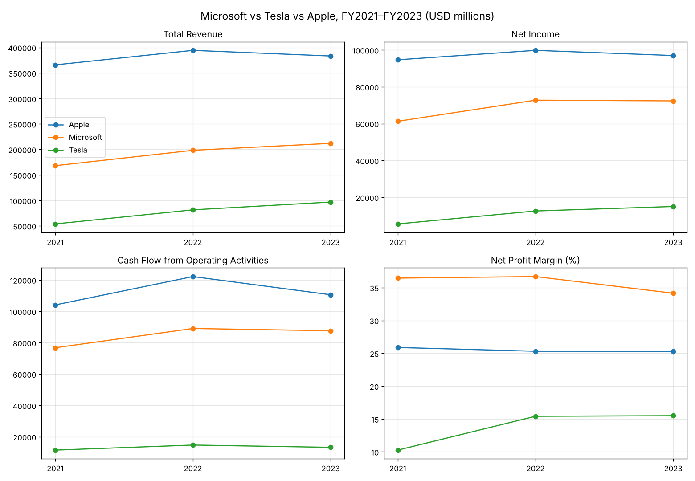

# BCG X GenAI Job Simulation (Forage)

My solution to the [BCG X GenAI job simulation](https://www.theforage.com/simulations/bcg/gen-ai-anlo): extracting and analysing financial data from SEC 10-K filings, then building a financial chatbot on top of it.

## Repository structure
```
├── data/
│   ├── financial_data.csv                 # Raw metrics extracted from 10-K filings
│   └── financial_analysis.csv             # + YoY growth & ratios (Task 1 output)
├── task1/
│   ├── Task1_Financial_Data_Analysis.ipynb # Extraction, analysis, charts, findings
│   └── financial_trends.png
├── task2/
│   ├── financial_chatbot.py               # Rule-based financial chatbot
│   └── CHATBOT_DOCUMENTATION.md           # How it works, limitations, next steps
├── tests/test_chatbot.py
└── requirements.txt
```

## Task 1 — Data extraction & initial analysis
Five metrics — **Total Revenue, Net Income, Total Assets, Total Liabilities, Cash Flow from Operating Activities** — were extracted from the FY2021–FY2023 10-K filings of Microsoft, Tesla and Apple (USD millions), then analysed with pandas: year-over-year growth, net margin, return on assets, debt-to-equity, cash conversion and 3-year CAGR.

| FY2023 | Revenue | Net Income | Revenue YoY | Net Margin | Debt/Equity |
|---|---|---|---|---|---|
| Apple | $383.3B | $97.0B | −2.8% | 25.3% | 4.67x |
| Microsoft | $211.9B | $72.4B | +6.9% | 34.1% | 1.00x |
| Tesla | $96.8B | $15.0B | +18.8% | 15.5% | 0.68x |

**Highlights:** Tesla is the fastest grower (~34% revenue CAGR) but its operating cash flow fell 10% in FY23 while profit rose; Microsoft pairs double-digit growth with the highest margins and falling leverage; Apple is the largest and most cash-generative but saw revenue and profit dip in FY23.



## Task 2 — Financial chatbot
```bash
pip install -r requirements.txt
python task2/financial_chatbot.py --demo   # or run without --demo to chat
```
```
You: How has net income changed over the last year for Tesla?
Bot: Tesla's net income increased from $12.6 billion in 2022 to $15.0 billion in 2023, a change of +19.4%.
```
See [CHATBOT_DOCUMENTATION.md](task2/CHATBOT_DOCUMENTATION.md) for supported queries, limitations and next steps.

## Data sources
SEC EDGAR 10-K filings — Microsoft (CIK 789019), Tesla (CIK 1318605), Apple (CIK 320193).
